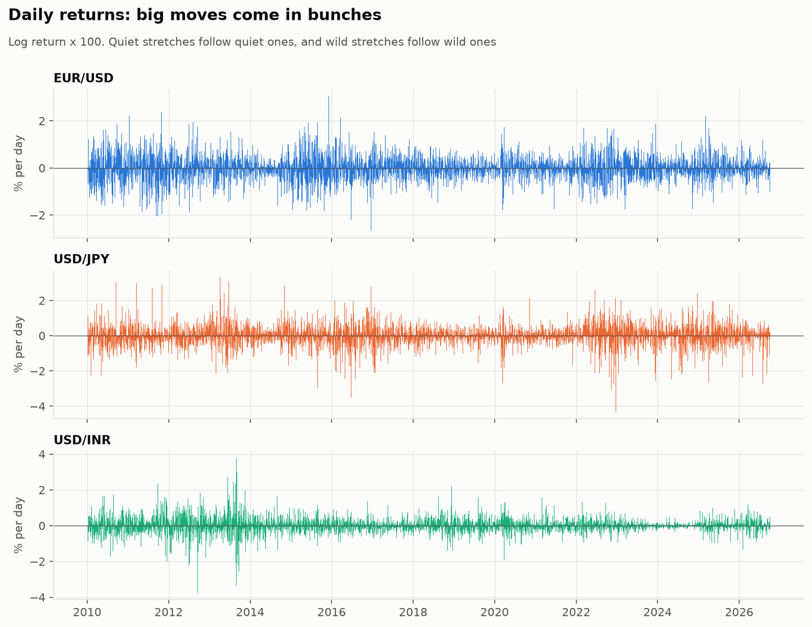
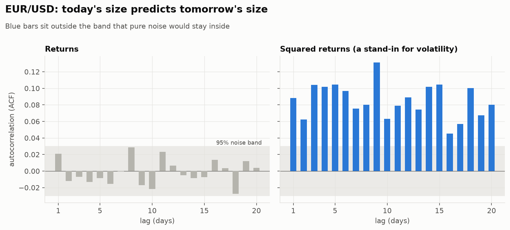
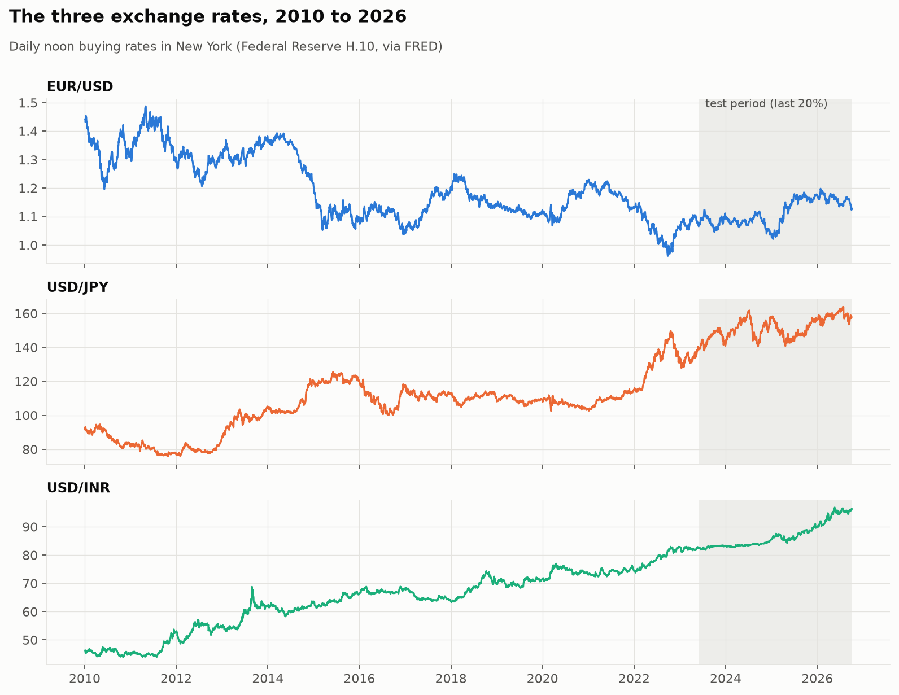
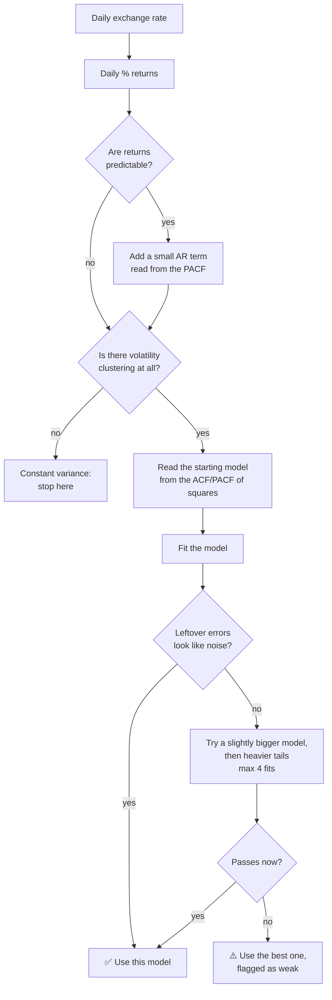
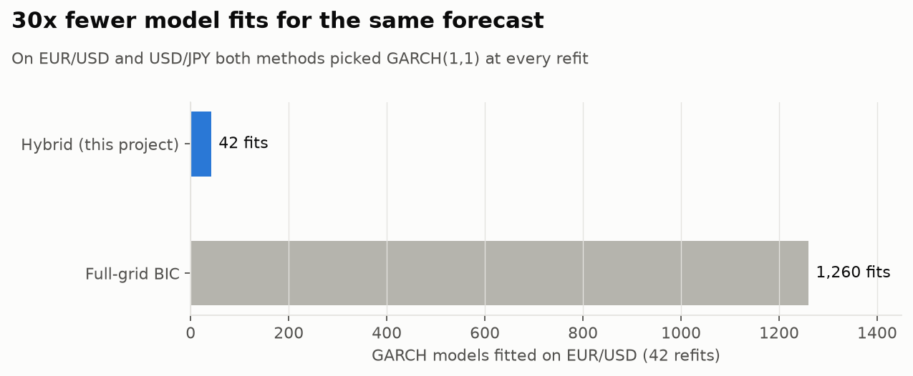
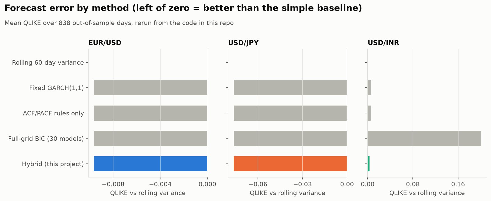
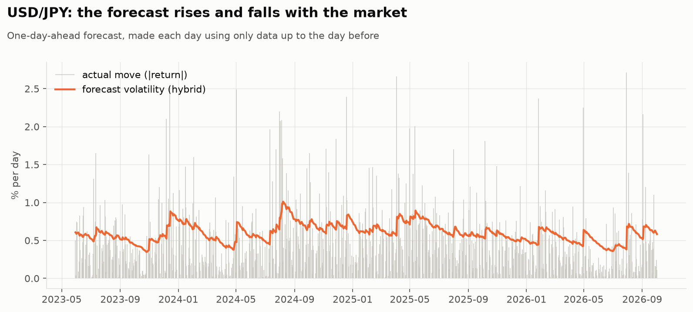
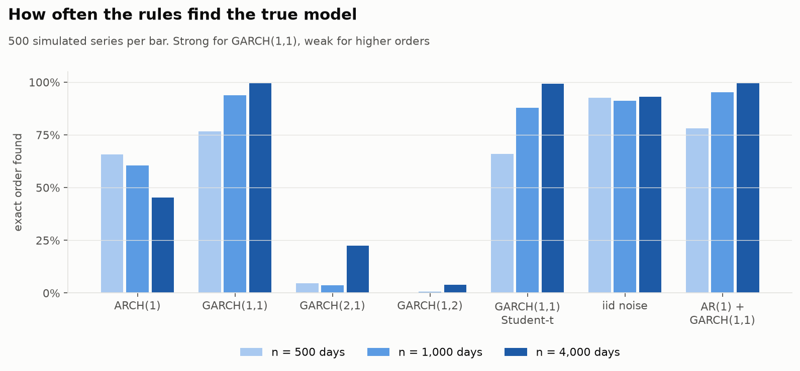

# Currency Volatility Forecasting

**Predicting how jumpy an exchange rate will be tomorrow, and finding the right model for that cheaply.**

We looked at 16 years of daily exchange rates for **EUR/USD, USD/JPY and USD/INR** and asked a simple question:

> Can you pick a good volatility model just by *looking at two charts* of the data,
> instead of trying 30 models and keeping the best one?

**Short answer:** yes, on this data. The chart-reading method made forecasts **as accurate** as the try-everything search while fitting **30 times fewer models** (42 instead of 1,260). It was not *more* accurate, and we say so.

> 👥 **Team project.** This was built together with **Arnav Chaturvedi** for an Advanced Time Series Analysis course. I was a collaborator on it, not the only person who made it. See [Credits](#credits).



---

## Contents

1. [Why would anyone care? Real-world scenarios](#why-would-anyone-care-real-world-scenarios)
2. [The idea in plain words](#the-idea-in-plain-words)
3. [Where the data comes from (map)](#where-the-data-comes-from)
4. [How the method works](#how-the-method-works)
5. [What we found](#what-we-found)
6. [Run it yourself](#run-it-yourself)
7. [Project structure](#project-structure)
8. [For the technical reader](#for-the-technical-reader)
9. [Limitations](#limitations)
10. [Credits](#credits)

---

## Why would anyone care? Real-world scenarios

Nobody can reliably predict *which way* a currency will move tomorrow. But you *can* predict **how much it is likely to move**: its volatility. That number drives real decisions:

| Who | Situation | What a volatility forecast tells them |
|---|---|---|
| 🎓 **A student going abroad** | An Indian student has to pay US tuition in three months and is converting rupees to dollars. | If USD/INR is expected to be calm, converting in one go is fine. If a jumpy period is forecast, splitting the transfer over several weeks lowers the risk of converting on a bad day. |
| 🏭 **An importer** | A Mumbai company pays a Japanese supplier in yen every month. | When volatility is forecast to rise, it is worth locking in a rate (hedging) before paying. When it's calm, the hedge may cost more than it saves. |
| 🏦 **A bank's risk desk** | A bank holds euros and has to report each morning how much it could lose in a bad day (Value-at-Risk). | Tomorrow's volatility is the main input to that number. Too low, and the bank holds too little safety capital. Too high, and capital sits idle. |
| 📈 **An options trader** | Options on EUR/USD are priced off expected volatility. | A better volatility forecast shows whether an option is cheap or expensive. |
| ✈️ **A traveller or freelancer** | A freelancer paid in euros wants to know when to convert to rupees. | A calm forecast means waiting costs little; a wild forecast means converting sooner is safer. |

All of these people use the same kind of model, called **GARCH**. Before using it, you have to choose its **settings** (how many past days it remembers). This project is about choosing those settings well **and cheaply**.

---

## The idea in plain words

**1. Big moves come in bunches.** Look at the chart above: quiet weeks follow quiet weeks, and wild weeks follow wild weeks (2022 for the yen, for example). This is called *volatility clustering*.

**2. You can see it in a chart.** Correlate each day's return with the return a few days earlier and you get almost nothing: the *direction* is unpredictable. Do the same with the *size* of the return (squared) and every bar sticks out: today's size really does predict tomorrow's.



**3. The shape of that chart hints at the right model.** Textbook time-series analysis (Box-Jenkins) reads model settings off these two charts, the **ACF** and **PACF**. We turned that reading into fixed rules a computer can follow.

**4. Then we check the model.** After fitting, the leftover errors should look like pure noise. If they don't, the method tries a slightly bigger model, then a heavier-tailed version, at most 4 fits in total.

**5. And we compare it fairly.** Against four other ways of forecasting, on the last 20% of the data (838 days per currency), which no rule had ever seen.

---

## Where the data comes from

Daily exchange rates published by the **US Federal Reserve** (H.10 release) and downloaded from **FRED**, the St. Louis Fed's free data service. Every rate is the noon buying rate in **New York**, so all three pairs are measured against the US dollar at the same time of day.

```geojson
{
  "type": "FeatureCollection",
  "features": [
    {"type": "Feature", "properties": {"name": "New York (USD): where every rate is recorded", "marker-color": "#0b0b0b", "marker-size": "large", "marker-symbol": "bank"},
     "geometry": {"type": "Point", "coordinates": [-74.006, 40.713]}},
    {"type": "Feature", "properties": {"name": "Eurozone (EUR): EUR/USD, from 1999", "marker-color": "#2a78d6", "marker-size": "medium"},
     "geometry": {"type": "Point", "coordinates": [8.682, 50.110]}},
    {"type": "Feature", "properties": {"name": "Japan (JPY): USD/JPY, from 1971", "marker-color": "#eb6834", "marker-size": "medium"},
     "geometry": {"type": "Point", "coordinates": [139.692, 35.690]}},
    {"type": "Feature", "properties": {"name": "India (INR): USD/INR, from 1973", "marker-color": "#1baf7a", "marker-size": "medium"},
     "geometry": {"type": "Point", "coordinates": [72.878, 19.076]}},
    {"type": "Feature", "properties": {"name": "EUR/USD", "stroke": "#2a78d6", "stroke-width": 3},
     "geometry": {"type": "LineString", "coordinates": [[-74.006, 40.713], [8.682, 50.110]]}},
    {"type": "Feature", "properties": {"name": "USD/JPY", "stroke": "#eb6834", "stroke-width": 3},
     "geometry": {"type": "LineString", "coordinates": [[-74.006, 40.713], [139.692, 35.690]]}},
    {"type": "Feature", "properties": {"name": "USD/INR", "stroke": "#1baf7a", "stroke-width": 3},
     "geometry": {"type": "LineString", "coordinates": [[-74.006, 40.713], [72.878, 19.076]]}}
  ]
}
```

*GitHub draws the block above as an interactive map. Click a marker to see the pair.*

| Pair | FRED id | Why it's in the study |
|---|---|---|
| **EUR/USD** | `DEXUSEU` | The most traded pair in the world: deep, liquid, "well behaved". |
| **USD/JPY** | `DEXJPUS` | A big pair with sharp episodes, like the 2022 yen slide. |
| **USD/INR** | `DEXINUS` | The stress test: a managed currency with many days of no change, sudden jumps, and returns that are partly predictable. |

The study uses data from **1 Jan 2010 to 2 Oct 2026** (about 4,190 trading days per pair). The raw files are kept in [`data/raw/`](data/raw) so every number here can be reproduced exactly.



---

## How the method works



**Five ways of forecasting were compared**, all predicting tomorrow's volatility using only data up to today:

| Method | What it does | Models fitted per refit |
|---|---|---|
| Rolling 60-day variance | Just the spread of the last 60 days. No model. | 0 |
| Fixed GARCH(1,1) | Always the textbook default model. | 1 |
| ACF/PACF rules only | Our rules' first guess, no checking. | 1 |
| Full-grid BIC | Try all 30 combinations, keep the best score. | 30 |
| **Hybrid (this project)** | Rules + check + small repair if needed. | 1 to 4 |

Each method is re-run every 20 days on all the data so far (42 refits over the test period).

---

## What we found

### 1. Same accuracy, a fraction of the work

On EUR/USD and USD/JPY every GARCH-based method picked the **same model at all 42 refits**, so their forecasts were identical. The hybrid got there with 42 fits; the full grid needed 1,260.



### 2. GARCH beats the simple baseline, but not by a provable margin

Lower QLIKE (a standard score for volatility forecasts) is better. GARCH was a little better than the 60-day rolling variance on EUR/USD and USD/JPY, but a Diebold-Mariano test says the gap could be chance (p = 0.51 and 0.14).



### 3. USD/INR is where things break, and the safety net matters

For USD/INR most fitted models ended up "on the edge" (a volatility that never fades), so the method rejected them and fell back to the rolling variance. The full grid had no such check and forced its fits through. Result: the **hybrid clearly beat the full grid** (p = 0.001), and the full grid was clearly *worse* than doing nothing clever (p = 0.005).

| Pair | Method | QLIKE (lower = better) | Models fitted |
|---|---|---:|---:|
| EUR/USD | Rolling variance | −0.7534 | 0 |
| EUR/USD | Every GARCH method (identical) | **−0.7630** | 42 (grid: 1,260) |
| USD/JPY | Rolling variance | 0.1210 | 0 |
| USD/JPY | Every GARCH method (identical) | **0.0447** | 42 (grid: 1,260) |
| USD/INR | Rolling variance | **−2.1046** | 0 |
| USD/INR | Hybrid | −2.1014 | 142 |
| USD/INR | Full-grid BIC | −1.9041 | 1,260 |

### 4. The forecast follows the market



### 5. How often do the rules find the *true* model?

Real data never tells you the true model, so we simulated data from models we chose, and counted how often the method found the right one. It is excellent for GARCH(1,1), the model real currency data usually follows (94% at 1,000 days, 99.6% at 4,000). It is weak for less common shapes, and for a strong ARCH(1) it gets *worse* with more data. The likely reason: the usual "noise band" is too narrow for such heavy-tailed data, so chance spikes look real.



### The honest summary

- ✅ **Cheaper:** about 30× fewer model fits than an exhaustive search.
- ✅ **As accurate** on these three currencies.
- ❌ **Not shown to be better** than simply always using GARCH(1,1).
- ⚠️ **Weak at recovering unusual model shapes**, and we report where it fails.

---

## Run it yourself

```bash
git clone https://github.com/figureitoutkrish/currency-volatility-forecasting.git
cd currency-volatility-forecasting
python -m venv .venv && source .venv/bin/activate
pip install -r requirements.txt

python scripts/run_forecasts.py   # a few minutes: forecasts + scores into results/
python scripts/make_charts.py     # redraws every chart in images/
```

Try the selector on one currency in a Python shell:

```python
from src.data import load_config, load_fx, to_log_returns
from src.selector import select_and_fit

cfg = load_config()
returns = to_log_returns(load_fx("DEXJPUS", cfg["start"], cfg=cfg))
result = select_and_fit(returns.to_numpy(), cfg)

print(result["order"])          # (1, 1) -> GARCH(1,1)
print(result["models_fitted"])  # 1
print(result["reason"])         # the rules' reasoning, in words
```

Every threshold, date, seed and currency pair lives in [`config.yaml`](config.yaml). Change a pair id to any daily FRED series (for example `DEXUSUK` for GBP/USD) and the data downloads automatically.

---

## Project structure

```
currency-volatility-forecasting/
├── config.yaml            # every setting in one place
├── data/raw/              # FRED downloads (fixed, so results are reproducible)
├── results/               # forecasts per day + score tables (made by run_forecasts.py)
├── images/                # charts in this README (made by make_charts.py)
├── scripts/
│   ├── run_forecasts.py   # run all five methods on all three pairs, then score them
│   └── make_charts.py     # draw the charts
└── src/
    ├── data.py            # load FRED data, compute % log returns
    ├── correlogram.py     # ACF / PACF and the noise band
    ├── stat_tests.py      # Ljung-Box, ARCH-LM, ADF/KPSS
    ├── rules.py           # the chart-reading rules
    ├── selector.py        # rules -> fit -> check -> repair (the hybrid)
    ├── baselines.py       # the four comparison methods
    ├── forecast.py        # rolling one-day-ahead forecasts, no look-ahead
    ├── evaluate.py        # QLIKE, MSE, Diebold-Mariano tests
    ├── simulate.py        # simulated data with a known true model
    ├── plots.py           # Plotly figures for the dashboard
    └── dashboard.py       # helpers for the interactive dashboard
```

---

## For the technical reader

<details>
<summary><b>Model and notation</b></summary>

GARCH(p, q) in the `arch` package's convention: p lags of squared shocks, q lags of the variance.

$$\sigma_t^2 = \omega + \sum_{i=1}^{p} \alpha_i\, \varepsilon_{t-i}^2 + \sum_{j=1}^{q} \beta_j\, \sigma_{t-j}^2$$

Returns are log returns × 100. The mean is a constant or AR(m) with m ≤ 2.
</details>

<details>
<summary><b>The selection rules</b></summary>

| Step | Rule |
|---|---|
| Mean | Ljung-Box(10) on returns; if it rejects, AR order m ≤ 2 = last significant PACF lag |
| Volatility check | Ljung-Box and ARCH-LM on squared residuals; no effect → constant variance |
| Variance | PACF of squares cuts off at p ≤ 3, is quiet for 3 lags after, and the ACF of squares has ≤ 3 spikes in lags 10 to 20 → ARCH(p); otherwise GARCH(1,1) |
| Validity | Reject if ω ≤ 0, any coefficient < 0, or α + β ≥ 1 − 10⁻⁶ |
| Gate | Squared standardised residuals: Ljung-Box at lags 5, 10, 20 and ARCH-LM(5), all p > 0.05 |
| Escalation | Best-BIC neighbour (p+1, q) or (p, q+1), capped at 3 → Student-t errors → lowest-BIC valid fit, flagged. At most 4 fits |

The thresholds were calibrated once on simulated data, then **frozen before any forecast was scored**. Real data never tuned a rule.
</details>

<details>
<summary><b>Evaluation design</b></summary>

- **Forecast:** one-day-ahead conditional variance, expanding window, full reselection every 20 test days (42 refits). Between refits the parameters stay fixed but the variance is re-filtered through new returns. No look-ahead.
- **Fallback:** if every fit at a refit is invalid, that block uses the rolling 60-day variance, and the share of such days is reported.
- **Target:** the squared return, a noisy but standard proxy for variance.
- **Losses:** QLIKE = ln h + r²/h (primary, robust to proxy noise) and MSE = (r² − h)².
- **Test:** Diebold-Mariano with a Newey-West long-run variance, L = ⌊4(T/100)^(2/9)⌋, plus L = 20 as a robustness check. A result counts as robust only if p < 0.05 under both.
- **Order recovery:** R = 500 simulated series per cell at n = 500, 1,000, 4,000 for ARCH(1), GARCH(1,1), GARCH(2,1), GARCH(1,2), GARCH(1,1)-t, iid noise and AR(1)+GARCH(1,1). Monte Carlo SE ≤ 0.022.

Diebold-Mariano results (QLIKE, all test days):

| Pair | A vs B | Mean loss diff | p | p (L = 20) | Reading |
|---|---|---:|---:|---:|---|
| EUR/USD | hybrid vs rolling | −0.0096 | 0.51 | 0.53 | not significant |
| USD/JPY | hybrid vs rolling | −0.0763 | 0.14 | 0.12 | not significant |
| USD/INR | hybrid vs full grid | −0.1972 | 0.0012 | 0.0056 | hybrid better, robust |
| USD/INR | full grid vs rolling | +0.2005 | 0.0052 | 0.0176 | full grid worse, robust |
| USD/INR | hybrid vs fixed GARCH | −0.0019 | 0.68 | 0.70 | not significant |
| USD/INR | hybrid vs rolling | +0.0033 | 0.93 | 0.94 | not significant |
</details>

<details>
<summary><b>Reproducibility notes</b></summary>

- `scripts/run_forecasts.py` reproduces the forecast and Diebold-Mariano numbers above **exactly** from the files in `data/raw/`.
- The order-recovery chart shows the original study's Monte Carlo results. The simulated models' parameters and seeds in `config.yaml` are stand-ins, so rerunning `simulate.recovery_table` gives close but not identical rates.
- The interactive Streamlit front-end of the original project is not included; `src/plots.py` and `src/dashboard.py` hold its chart and table helpers.
</details>

**Built with:** Python, [`arch`](https://github.com/bashtage/arch), statsmodels, pandas, NumPy, SciPy, joblib, Matplotlib and Plotly. Only the simulation recursion, QLIKE and the Diebold-Mariano test are hand-written.

---

## Limitations

- FRED rates are New York **noon** rates, not closing prices.
- The squared return is a very noisy stand-in for true volatility, so only averages over many days mean anything.
- No correction for running many tests at once.
- The usual 95% noise band assumes light tails, which squared currency returns don't have.
- The rules can only propose ARCH(p ≤ 3) or GARCH(1,1); anything else has to come from the repair step.

**Ideas for later:** a heavy-tail-aware noise band, rules that can propose GARCH(2,1) and (1,2) directly, intraday "realised" volatility as the target, and more currency pairs.

---

## Credits

This was a **team project** for an Advanced Time Series Analysis course. I worked on it as a collaborator; it was **not built by me alone**.

- **Arnav Chaturvedi**, collaborator
- **Krish Viramgama**, collaborator ([@figureitoutkrish](https://github.com/figureitoutkrish))

**Data:** Board of Governors of the Federal Reserve System, H.10 release, via FRED (Federal Reserve Bank of St. Louis).

**Key references:** Engle (1982) on ARCH · Bollerslev (1986) on GARCH · Box & Jenkins, *Time Series Analysis* · Diebold & Mariano (1995) · Newey & West (1987) · Patton (2011) on volatility forecast comparison.
